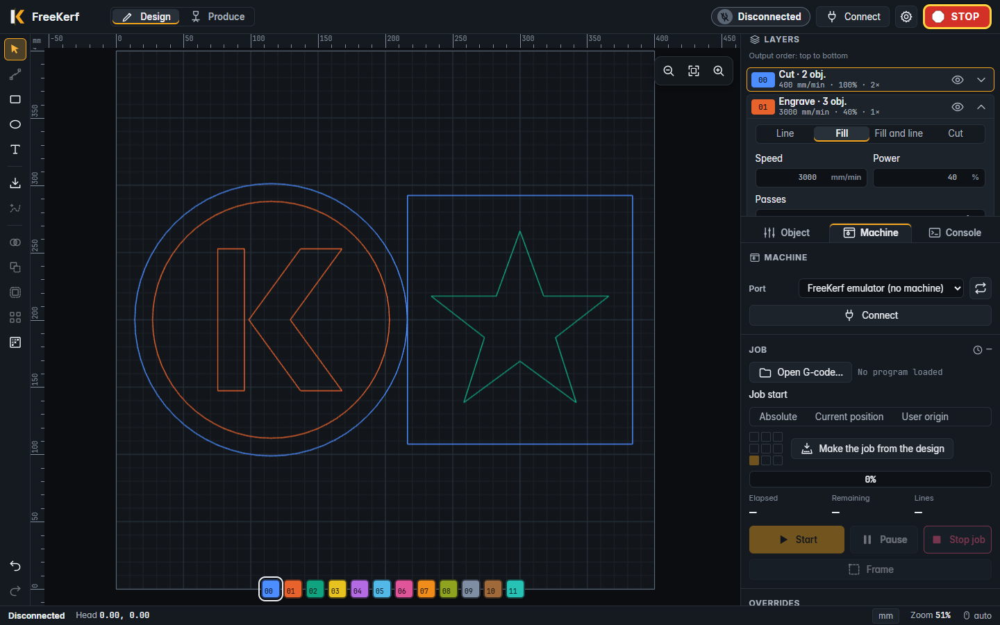

# FreeKerf Website

The public site of [FreeKerf](https://github.com/freekerf/freekerf): free software that
designs laser jobs and drives the machine. The site is the entry point to the app: what
it is, how it looks running, where the project stands and where to download it.

> **Status: milestone 1** (landing and download page, English and Brazilian Portuguese).
> The user guide in `src/content/docs/` is drafted and will be published in milestone 3.
> See **[PLAN.md](PLAN.md)**.



```bash
npm ci
npm run dev        # http://localhost:4321/website/
npm test           # unit + integration
npm run test:e2e   # Playwright + axe
```

How to work on it: **[AGENTS.md](AGENTS.md)**. Documentation about the site: [`doc/`](doc/).

License: [GPL-3.0-or-later](LICENSE). Derived from LaserGRBL, Copyright (c) 2016 Diego Settimi ([NOTICE](NOTICE)).
