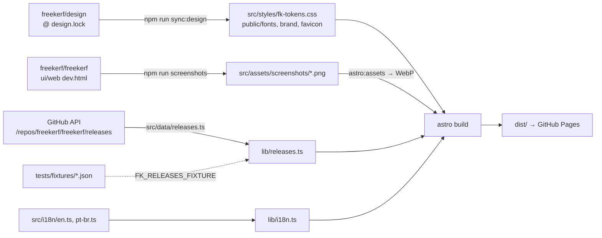

# Architecture

The site is static: `astro build` writes HTML, CSS, WebP images and the synced
design files to `dist/`, and GitHub Pages serves them. Nothing runs on a server and
the pages make no third-party requests.

## Generator

Astro 7 with file routes (`src/pages/`) and its i18n routing: English at the root,
other locales under a prefix (`/pt-br/`). Each route only picks a locale and renders
a view from `src/views/`, so a page is written once for every language. See
[ADR 0001](adr/0001-site-generator.md).

The user guide drafts in `src/content/docs/` use Starlight frontmatter; Starlight, an
Astro integration, will publish them in milestone 3 next to the current pages.

## Design sync

The look comes from the `fk-` tokens, fonts and logos of `freekerf/design`, read at the
commit in `design.lock` with `git show` and copied byte for byte
([features/design-sync.md](features/design-sync.md)). `src/styles/site.css` only uses
`--fk-*` variables for colour.

## Releases

`src/data/releases.ts` reads the app's releases once per build: from the GitHub API, or
from a recorded answer when `FK_RELEASES_FIXTURE` is set (tests). `src/lib/releases.ts`
parses them, picks the latest stable release and sorts its installers per system
([features/download-picker.md](features/download-picker.md)). A new release appears on
the site at the next deployment (pushes to `main`, and a daily scheduled run).

## Screenshots

Generated from the app itself: its web front end on the development fake service, driven
by Playwright ([features/screenshots.md](features/screenshots.md)). Astro converts them to
WebP at two widths; `<picture>` shows the light one when the system theme is light.

## Deployment

`.github/workflows/deploy.yml` builds on `main` and publishes with GitHub Pages
([features/deployment.md](features/deployment.md)). The base path comes from the Pages
configuration (`/website/` today, `/` with the custom domain).
